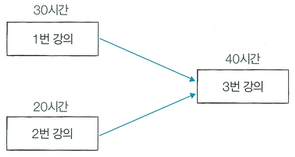

동빈이는 온라인으로 컴퓨터공학 강의를 듣고 있다. 이때 각 온라인 강의는 선수 강의가 있을 수 있는데, 선수 강의가 있는 강의는 선수 강의를 먼저 들어야만 해당 강의를 들을 수 있다. 예를 들어 '알고리즘' 강의의 선수 강의로 '자료구조'와 '컴퓨터 기초'가 존재한다면, '자료구조'와 '컴퓨터 기초'를 모두 들은 이후에 '알고리즘' 강의를 들을 수 있다.

동빈이는 총 n개의 강의를 듣고자 한다. 모든 강의는 1번부터 n번까지의 번호를 가진다. 또한 동시에 여러 개의 강의를 들을 수 있다고 가정한다. 예를 들어 n = 3일 때, 3번 강의의 선수 강의로 1번과 2번 강의가 있고, 1번과 2번 강의는 선수 강의가 없다고 가정하자. 그리고 각 강의에 대하여 강의 시간이 다음과 같다고 가정하자.

- 1번 강의: 30시간
- 2번 강의: 20시간
- 3번 강의: 40시간

이 경우 1번 강의를 수강하기까지의 최소 시간은 30시간, 2번 강의를 수강하기까지의 최소 시간은 20시간, 3번 강의를 수강하기까지의 최소 시간은 70시간이다.

동빈이가 듣고자 하는 n개의 강의 정보가 주어졌을 때, n개의 강의에 대하여 수강하기까지 걸리는 최소 시간을 각각 반환하는 프로그램을 작성하시오.

## 함수 설명

`def solution(n, courses):`

아래 인자를 받는 solution 함수를 완성하세요. 문제 설명과 제한 사항은 함수 인자와 같은 이름을 사용합니다. 배열과 함께 주어지는 개수는 배열 길이와 일치합니다.

- `n` (정수): 문제에서 설명한 n 값
- `courses` (정수 배열 배열): 강의 번호 순서로 [강의 시간, 선수 강의 번호, ...]를 담은 배열

`courses[i]`는 `[강의 시간, 선수 강의 번호, ...]`입니다. 끝을 나타내는 -1은 포함하지 않습니다.

## 반환값

- n개의 강의에 대하여 수강하기까지 걸리는 최소 시간을  반환한다.

반환 형식: **정수 배열**. 여러 값을 출력하던 문제는 예시와 같이 배열로 반환합니다. 문자열의 대소문자는 예시와 동일하게 맞추세요.

## 제한 사항

- 1 ≤ n ≤ 500
- len(courses) = n
- courses[i] = [강의 시간, 선수 강의 번호, ...]이며 -1은 포함하지 않습니다.
- 강의 시간은 1 이상 100,000 이하이고 강의 번호는 1부터 n까지입니다.
