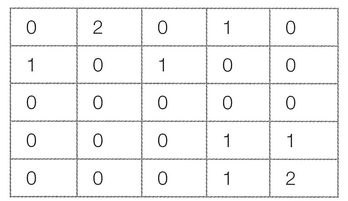

크기가 n × n인 도시가 있습니다. 도시는 1 × 1 크기의 칸으로 나누어져 있습니다. 도시의 각 칸은 빈칸, 치킨집, 집 중 하나입니다. 도시의 칸은 (r, c)와 같은 형태로 나타내고, r행 c열 또는 위에서부터 r번째 칸, 왼쪽에서부터 c번째 칸을 의미합니다. r과 c는 1부터 시작합니다.

이 도시에 사는 사람들은 치킨을 매우 좋아합니다. 따라서 사람들은 "치킨 거리"라는 말을 주로 사용합니다. 치킨 거리는 집과 가장 가까운 치킨집 사이의 거리입니다. 즉, 치킨 거리는 집을 기준으로 정해지며, 각각의 집은 치킨 거리를 가지고 있습니다. 도시의 치킨 거리는 모든 집의 치킨 거리의 합입니다.

임의의 두 칸 (r₁, c₁)과 (r₂, c₂) 사이의 거리는 |r₁ - r₂| + |c₁ - c₂|로 구합니다.

예를 들어, 다음과 같은 지도를 갖는 도시를 살펴봅시다.

0은 빈칸, 1은 집, 2는 치킨집입니다.

(2, 1)에 있는 집과 (1, 2)에 있는 치킨집과의 거리는 |2 - 1| + |1 - 2| = 2, (5, 5)에 있는 치킨집과의 거리는 |2 - 5| + |1 - 5| = 7입니다. 따라서 (2, 1)에 있는 집의 치킨 거리는 2입니다.

(5, 4)에 있는 집과 (1, 2)에 있는 치킨집과의 거리는 |5 - 1| + |4 - 2| = 6, (5, 5)에 있는 치킨집과의 거리는 |5 - 5| + |4 - 5| = 1입니다. 따라서 (5, 4)에 있는 집의 치킨 거리는 1입니다.

이 도시에 있는 치킨집은 모두 같은 프랜차이즈입니다. 프랜차이즈 본사에서는 수익을 증가시키기 위해 일부 치킨집을 폐업시키려고 합니다. 오랜 연구 끝에 이 도시에서 가장 수익을 많이 낼 수 있는 치킨집의 개수는 최대 m개라는 사실을 알아냈습니다.

도시에 있는 치킨집 중에서 최대 m개를 고르고, 나머지 치킨집은 모두 폐업시켜야 합니다. 어떻게 고르면, 도시의 치킨 거리가 가장 작게 될지 구하는 프로그램을 작성하세요.

## 함수 설명

`def solution(n, m, city):`

아래 인자를 받는 solution 함수를 완성하세요. 문제 설명과 제한 사항은 함수 인자와 같은 이름을 사용합니다. 배열과 함께 주어지는 개수는 배열 길이와 일치합니다.

- `n` (정수): 문제에서 설명한 n 값
- `m` (정수): 문제에서 설명한 m 값
- `city` (정수 배열 배열): 도시의 2차원 정수 배열

## 반환값

-  폐업시키지 않을 치킨집을 최대 m개를 골랐을 때, 도시의 치킨 거리의 최솟값을 반환합니다.

반환 형식: **정수**.

## 제한 사항

- 2 ≤ n ≤ 50, 1 ≤ m ≤ 13
- city는 n × n 정수 배열이며 0은 빈칸, 1은 집, 2는 치킨집입니다.
- 집은 1개 이상 2n개 이하이고 치킨집은 m개 이상 13개 이하입니다.
