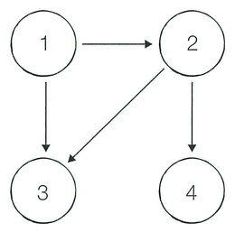

어떤 나라에는 1~n번까지의 도시와 m개의 단방향 도로가 존재합니다. 모든 도로의 거리는 1입니다. 이때 특정한 도시 x로부터 출발하여 도달할 수 있는 모든 도시 중에서, 최단 거리가 정확히 k인 모든 도시의 번호를 반환하는 프로그램을 작성하세요. 또한 출발 도시 x에서 출발 도시 x로 가는 최단 거리는 항상 0이라고 가정합니다.

예를 들어 n = 4, k = 2, x = 1일 때 다음과 같이 그래프가 구성되어 있다고 합시다.

이때 1번 도시에서 출발하여 도달할 수 있는 도시 중에서, 최단 거리가 2인 도시는 4번 도시뿐입니다. 2번과 3번 도시의 경우, 최단 거리가 1이기 때문에 출력하지 않습니다.

## 함수 설명

`def solution(n, m, k, x, roads):`

아래 인자를 받는 solution 함수를 완성하세요. 문제 설명과 제한 사항은 함수 인자와 같은 이름을 사용합니다. 배열과 함께 주어지는 개수는 배열 길이와 일치합니다.

- `n` (정수): 문제에서 설명한 n 값
- `m` (정수): 문제에서 설명한 m 값
- `k` (정수): 문제에서 설명한 k 값
- `x` (정수): 문제에서 설명한 x 값
- `roads` (정수 배열 배열): 원문 순서대로 각 도로의 정보를 담은 2차원 정수 배열

도시 번호를 오름차순 정수 배열로 반환하세요. 해당 도시가 없으면 `[-1]`을 반환하세요.

`roads[i] = [출발 도시 a, 도착 도시 b]`입니다.

## 반환값

- x로부터 출발하여 도달할 수 있는 도시 중에서, 최단 거리가 k인 모든 도시의 번호를  오름차순으로 반환합니다.
- 이때 도달할 수 있는 도시 중에서, 최단 거리가 k인 도시가 하나도 존재하지 않으면 -1을 반환합니다.

반환 형식: **정수 배열**. 여러 값을 출력하던 문제는 예시와 같이 배열로 반환합니다. 문자열의 대소문자는 예시와 동일하게 맞추세요.

## 제한 사항

- 2 ≤ n ≤ 300,000, 1 ≤ m ≤ 1,000,000
- 1 ≤ k ≤ 300,000, 1 ≤ x ≤ n
- len(roads) = m
- 각 단방향 도로 [a, b]에서 1 ≤ a, b ≤ n이고 a ≠ b입니다.
