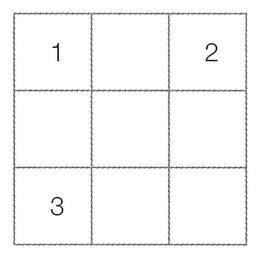
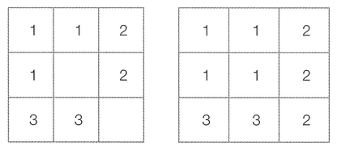

n × n 크기의 시험관이 있습니다. 시험관은 1 × 1 크기의 칸으로 나누어지며, 특정한 위치에는 바이러스가 존재할 수 있습니다. 바이러스의 종류는 1~k번까지 k가지가 있으며 모든 바이러스는 이 중 하나에 속합니다.

시험관에 존재하는 모든 바이러스는 1초마다 상, 하, 좌, 우의 방향으로 증식하는데, 매 초 번호가 낮은 종류의 바이러스부터 먼저 증식합니다. 또한 증식 과정에서 특정한 칸에 이미 어떠한 바이러스가 있다면, 그곳에는 다른 바이러스가 들어갈 수 없습니다.

시험관의 크기와 바이러스의 위치 정보가 주어졌을 때, s초가 지난 후에 (x, y)에 존재하는 바이러스의 종류를 반환하는 프로그램을 작성하세요. 만약 s초가 지난 후에 해당 위치에 바이러스가 존재하지 않는다면, 0을 반환합니다. 이때 x와 y는 각각 행과 열의 위치를 의미하며, 시험관의 가장 왼쪽 위에 해당하는 곳은 (1, 1)에 해당합니다.

예를 들어 다음과 같이 3 × 3 크기의 시험관에 서로 다른 1번, 2번, 3번 바이러스가 각각 (1, 1), (1, 3), (3, 1)에 위치해 있을 때, 2초가 지난 뒤에 (3, 2)에 존재하는 바이러스의 종류를 계산해보겠습니다.

다음 왼쪽 그림은 1초가 지난 뒤의 시험관 상태이고, 오른쪽 그림은 2초가 지난 뒤의 시험관 상태입니다.

결과적으로 2초가 지난 뒤에 (3, 2)에 존재하는 바이러스의 종류는 3번 바이러스입니다. 따라서 3을 출력하면 정답입니다.

## 함수 설명

`def solution(n, k, board, s, x, y):`

아래 인자를 받는 solution 함수를 완성하세요. 문제 설명과 제한 사항은 함수 인자와 같은 이름을 사용합니다. 배열과 함께 주어지는 개수는 배열 길이와 일치합니다.

- `n` (정수): 문제에서 설명한 n 값
- `k` (정수): 문제에서 설명한 k 값
- `board` (정수 배열 배열): 문제에서 설명한 격자 정보
- `s` (정수): 원문의 s (문자열 문제에서는 문자열, 시간 문제에서는 초 단위 정수): 원문의 s (문자열 문제에서는 문자열, 시간 문제에서는 초 단위 정수)
- `x` (정수): 문제에서 설명한 x 값
- `y` (정수): 문제에서 설명한 y 값

## 반환값

- s초 뒤에 (x, y)에 존재하는 바이러스의 종류를 반환합니다. 만약 s초 뒤에 해당 위치에 바이러스가 존재하지 않는다면, 0을 반환합니다.

반환 형식: **정수**.

## 제한 사항

- 1 ≤ n ≤ 200, 1 ≤ k ≤ 1,000
- board는 n × n 정수 배열이며 원소는 0 이상 k 이하입니다. 0은 빈칸입니다.
- 0 ≤ s ≤ 10,000, 1 ≤ x, y ≤ n
- 좌표 [x, y]는 1부터 시작하므로 배열에서는 board[x - 1][y - 1]에 해당합니다.
