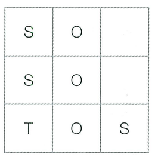
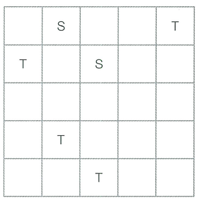
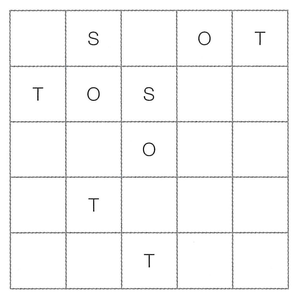

N × N 크기의 복도가 있습니다. 이 복도는 1 × 1 크기의 칸으로 나누어지며, 특정한 위치에는 선생님, 학생, 혹은 장애물이 있습니다. 현재 학생 몇 명이 수업 시간에 몰래 복도에 나왔는데, 복도에 나온 학생들이 선생님의 감시에 들키지 않는 것이 목표입니다.

각 선생님은 자신의 위치에서 상, 하, 좌, 우 4가지 방향으로 감시를 진행합니다. 단, 복도에 장애물이 있으면 선생님은 장애물 뒤편에 숨어 있는 학생을 볼 수 없습니다. 또한 선생님은 시력이 매우 좋아 아무리 멀리 있더라도 장애물로 막히기 전까지 4가지 방향으로 학생을 모두 볼 수 있다고 합니다.

문제에서 위칫값을 나타낼 때는 (행, 열)의 형태로 표현합니다. 각 칸은 선생님이 존재하면 T, 학생이 존재하면 S, 장애물이 존재하면 O로 표시합니다. 다음 그림을 해석하면 복도가 3 × 3 크기일 때 (3, 1)에는 선생님이 존재하며 (1, 1), (2, 1), (3, 3)의 위치에는 학생이 존재합니다. 그리고 (1, 2), (2, 2), (3, 2)의 위치에는 장애물이 존재합니다.

이때 (3, 3)의 위치에 존재하는 학생은 장애물 뒤편에 숨어 있기 때문에 감시를 피할 수 있지만, (1, 1)과 (2, 1)의 위치에 존재하는 학생은 선생님에게 들킵니다.

학생들은 복도의 빈칸 중에서 장애물을 설치할 위치를 골라, 정확히 3개의 장애물을 설치해야 합니다. 그리고 장애물을 3개 설치해서 선생님의 감시로부터 모든 학생이 피할 수 있는지 계산해야 합니다. N × N 크기의 복도에서 학생과 선생님의 위치 정보가 주어졌을 때, 장애물을 정확히 3개 설치하여 모든 학생이 선생님의 감시를 피할 수 있는지 반환하는 프로그램을 작성하세요.

예를 들어 N = 5일 때, 선생님과 학생의 위치 정보가 다음과 같다고 합시다.

이때 장애물 3개를 다음처럼 설치하면 선생님의 감시로부터 모든 학생이 피할 수 있습니다.

## 함수 설명

`def solution(n, hallway):`

아래 매개변수는 원문에 등장하는 값과 같은 의미입니다. 배열 길이와 함께 주어지는 개수는 항상 일치합니다. 표준입력을 읽거나 정답을 출력할 필요 없이 결과를 반환하세요.

- `n` (정수): 원문의 N에 해당하는 값
- `hallway` (문자열 배열 배열): "S", "T", "X"로 구성된 2차원 문자열 배열

## 반환값

-  정확히 3개의 장애물을 설치하여 모든 학생들을 감시로부터 피하도록 할 수 있는지의 여부를 반환합니다. 모든 학생들을 감시로부터 피하도록 할 수 있다면 "YES", 그렇지 않다면 "NO"를 반환합니다.

반환 형식: **문자열**. 여러 값을 출력하던 문제는 예시와 같이 배열로 반환합니다. 문자열의 대소문자는 예시와 동일하게 맞추세요.

## 제한 사항

N, M 등의 기호는 같은 이름의 소문자 매개변수 또는 해당 배열의 길이를 뜻합니다. 각 배열의 원소 순서와 번호 체계는 문제 설명을 따릅니다.
-  자연수 N이 주어집니다. (3 ≤ N ≤ 6)
-  복도의 정보가 주어집니다. 각 행에서는 N개의 원소가 주어지며,  해당 위치에 학생이 있다면 S, 선생님이 있다면 T, 아무것도 존재하지 않는다면 X가 주어집니다. 단, 항상 빈칸의 개수는 3개 이상으로 주어집니다.
