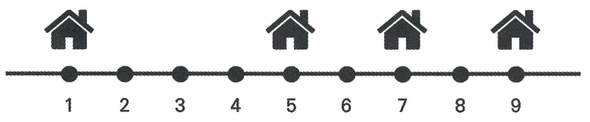

일직선상의 마을에 여러 채의 집이 위치해 있습니다. 이 중에서 특정 위치의 집에 특별히 한 개의 안테나를 설치하기로 결정했습니다. 효율성을 위해 안테나로부터 모든 집까지의 거리의 총합이 최소가 되도록 설치하려고 합니다. 이때 안테나는 집이 위치한 곳에만 설치할 수 있고, 논리적으로 동일한 위치에 여러 개의 집이 존재하는 것이 가능합니다.

집들의 위치 값이 주어질 때, 안테나를 설치할 위치를 선택하는 프로그램을 작성하세요.

예를 들어 n = 4이고, 각 위치가 1, 5, 7, 9일 때를 가정하겠습니다.

이 경우 5의 위치에 설치했을 때, 안테나로부터 모든 집까지의 거리의 총합이 (4 + 0 + 2 + 4) = 10으로, 최소가 됩니다.

## 함수 설명

`def solution(n, houses):`

아래 인자를 받는 solution 함수를 완성하세요. 문제 설명과 제한 사항은 함수 인자와 같은 이름을 사용합니다. 배열과 함께 주어지는 개수는 배열 길이와 일치합니다.

- `n` (정수): 문제에서 설명한 n 값
- `houses` (정수 배열): 집 위치의 정수 배열

## 반환값

-  안테나를 설치할 위치의 값을 반환합니다. 단, 안테나를 설치할 수 있는 위치 값으로 여러 개의 값이 도출될 경우 가장 작은 값을 반환합니다.

반환 형식: **정수**.

## 제한 사항

- 1 ≤ n ≤ 200,000
- len(houses) = n
- houses의 각 원소는 1 이상 100,000 이하의 정수입니다.
