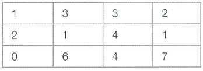

n × m 크기의 금광이 있습니다. 금광은 1 × 1 크기의 칸으로 나누어져 있으며, 각 칸은 특정한 크기의 금이 들어 있습니다. 채굴자는 첫 번째 열부터 출발하여 금을 캐기 시작합니다. 맨 처음에는 첫 번째 열의 어느 행에서든 출발할 수 있습니다. 이후에 m번에 걸쳐서 매번 오른쪽 위, 오른쪽, 오른쪽 아래 3가지 중 하나의 위치로 이동해야 합니다. 결과적으로 채굴자가 얻을 수 있는 금의 최대 크기를 반환하는 프로그램을 작성하세요.

만약 다음과 같이 3 × 4 크기의 금광이 존재한다고 가정합시다.

가장 왼쪽 위의 위치를 (1, 1), 가장 오른쪽 아래의 위치를 (n, m)이라고 할 때, 위 예시에서는 (2, 1) → (3, 2) → (3, 3) → (3, 4)의 위치로 이동하면 총 19만큼의 금을 채굴할 수 있으며, 이때의 값이 최댓값입니다.

## 함수 설명

`def solution(cases):`

아래 매개변수는 원문에 등장하는 값과 같은 의미입니다. 배열 길이와 함께 주어지는 개수는 항상 일치합니다. 표준입력을 읽거나 정답을 출력할 필요 없이 결과를 반환하세요.

- `cases` (정수 배열 배열 배열): 독립적으로 처리할 테스트 케이스들의 배열 (원소 구조는 아래 설명 참고)

`cases`는 금광 격자들의 배열입니다. 각 격자를 독립적으로 계산한 정수 결과를 순서대로 담은 배열을 반환하세요.

## 반환값

- 테스트 케이스마다 채굴자가 얻을 수 있는 금의 최대 크기를 반환합니다.

반환 형식: **정수 배열**. 여러 값을 출력하던 문제는 예시와 같이 배열로 반환합니다. 문자열의 대소문자는 예시와 동일하게 맞추세요.

## 제한 사항

N, M 등의 기호는 같은 이름의 소문자 매개변수 또는 해당 배열의 길이를 뜻합니다. 각 배열의 원소 순서와 번호 체계는 문제 설명을 따릅니다.
-  테스트 케이스 T가 입력됩니다. (1 ≤ T ≤ 1000)
- 매 테스트 케이스  n과 m이  입력됩니다. (1 ≤ n, m ≤ 20)  n × m개의 위치에 매장된 금의 개수가  입력됩니다. (1 ≤ 각 위치에 매장된 금의 개수 ≤ 100)
