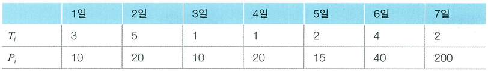

상담원으로 일하고 있는 백준이는 퇴사를 하려고 합니다. 오늘부터 n + 1일째 되는 날 퇴사를 하기 위해서, 남은 n일 동안 최대한 많은 상담을 하려고 합니다.

백준이는 비서에게 최대한 많은 상담을 잡으라고 부탁을 했고, 비서는 하루에 하나씩 서로 다른 사람의 상담을 잡아 놓았습니다.

각각의 상담은 상담을 완료하는 데 걸리는 기간 Ti와 상담을 했을 때 받을 수 있는 금액 Pi로 이루어져 있습니다.

n = 7인 경우에 다음과 같은 상담 일정표가 있습니다.

1일에 잡혀 있는 상담은 총 3일이 걸리며, 상담했을 때 받을 수 있는 금액은 10입니다. 5일에 잡혀 있는 상담은 총 2일이 걸리며, 받을 수 있는 금액은 15입니다.

상담하는 데 필요한 기간은 1일보다 클 수 있기 때문에, 모든 상담을 할 수는 없습니다. 예를 들어서 1일에 상담을 하게 되면, 2, 3일에 있는 상담은 할 수 없습니다. 2일에 있는 상담을 하게 되면, 3, 4, 5, 6일에 잡혀 있는 상담은 할 수 없습니다.

또한 n + 1일째에는 회사에 없기 때문에, 6, 7일에 있는 상담을 할 수 없습니다.

퇴사 전에 할 수 있는 상담의 최대 이익은 1일, 4일, 5일에 있는 상담을 하는 것이며, 이때의 이익은 10 + 20 + 15 = 45입니다.

상담을 적절히 했을 때, 백준이가 얻을 수 있는 최대 수익을 구하는 프로그램을 작성하세요.

## 함수 설명

`def solution(n, consultations):`

아래 인자를 받는 solution 함수를 완성하세요. 문제 설명과 제한 사항은 함수 인자와 같은 이름을 사용합니다. 배열과 함께 주어지는 개수는 배열 길이와 일치합니다.

- `n` (정수): 문제에서 설명한 n 값
- `consultations` (정수 배열 배열): 날짜 순서로 [소요 일수, 보수]를 담은 배열

`consultations[i] = [상담 기간 t_i, 보수 p_i]`입니다. i는 0부터 시작하며 실제 날짜는 i + 1일입니다.

## 반환값

-  백준이가 얻을 수 있는 최대 이익을 반환합니다.

반환 형식: **정수**.

## 제한 사항

- 1 ≤ n ≤ 15
- len(consultations) = n
- 각 [t_i, p_i]에 대해 1 ≤ t_i ≤ 5, 1 ≤ p_i ≤ 1,000입니다.
