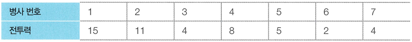
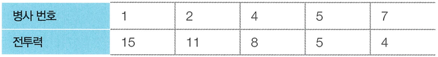

N명의 병사가 무작위로 나열되어 있습니다. 각 병사는 특정한 값의 전투력을 보유하고 있으며, 병사를 배치할 때는 전투력이 높은 병사가 앞쪽에 오도록 내림차순으로 배치를 하고자 합니다. 다시 말해 앞쪽에 있는 병사의 전투력이 항상 뒤쪽에 있는 병사보다 높아야 합니다.

또한 배치 과정에서는 특정한 위치에 있는 병사를 열외시키는 방법을 이용합니다. 그러면서도 남아 있는 병사의 수가 최대가 되도록 하고 싶습니다.

예를 들어, N = 7일 때 나열된 병사들의 전투력이 다음과 같다고 가정하겠습니다.

이때 3번 병사와 6번 병사를 열외시키면, 다음과 같이 남아 있는 병사의 수가 내림차순의 형태가 되며 5명이 됩니다. 이는 남아 있는 병사의 수가 최대가 되도록 하는 방법입니다.

병사에 대한 정보가 주어졌을 때, 남아 있는 병사의 수가 최대가 되도록 하기 위해서 열외시켜야 하는 병사의 수를 반환하는 프로그램을 작성하세요.

## 함수 설명

`def solution(n, soldiers):`

아래 매개변수는 원문에 등장하는 값과 같은 의미입니다. 배열 길이와 함께 주어지는 개수는 항상 일치합니다. 표준입력을 읽거나 정답을 출력할 필요 없이 결과를 반환하세요.

- `n` (정수): 원문의 N에 해당하는 값
- `soldiers` (정수 배열): 병사별 전투력 배열

## 반환값

-  남아 있는 병사의 수가 최대가 되도록 하기 위해서 열외시켜야 하는 병사의 수를 반환합니다.

반환 형식: **정수**. 여러 값을 출력하던 문제는 예시와 같이 배열로 반환합니다. 문자열의 대소문자는 예시와 동일하게 맞추세요.

## 제한 사항

N, M 등의 기호는 같은 이름의 소문자 매개변수 또는 해당 배열의 길이를 뜻합니다. 각 배열의 원소 순서와 번호 체계는 문제 설명을 따릅니다.
-  N이 주어집니다. (1 ≤ N ≤ 2,000)  각 병사의 전투력이  차례대로 주어집니다. 각 병사의 전투력은 10,000,000보다 작거나 같은 자연수입니다.
