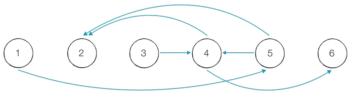

선생님은 시험을 본 학생 N명의 성적을 분실하고, 성적을 비교한 결과의 일부만 가지고 있습니다. 학생 N명의 성적은 모두 다른데, 다음은 6명의 학생에 대하여 6번만 성적을 비교한 결과입니다.

- 1번 학생의 성적 < 5번 학생의 성적
- 3번 학생의 성적 < 4번 학생의 성적
- 4번 학생의 성적 < 2번 학생의 성적
- 4번 학생의 성적 < 6번 학생의 성적
- 5번 학생의 성적 < 2번 학생의 성적
- 5번 학생의 성적 < 4번 학생의 성적

A번 학생의 성적이 B번 학생보다 낮다면 화살표가 A에서 B를 가리키도록 할 때 위의 성적 결과를 다음 그림처럼 표현할 수 있습니다.

이 그림으로 유추해서 순위를 정확히 알 수 있는 학생도 있고, 알 수 없는 학생도 있습니다. 예를 들어 1번 학생은 5번 학생보다 성적이 낮고, 5번 학생은 4번 학생보다 성적이 낮으므로 1번 학생은 4번 학생보다 성적이 낮습니다. 따라서 1번, 3번, 5번 학생은 모두 4번 학생보다 성적이 낮다고 볼 수 있습니다. 그리고 4번 학생은 2번 학생과 6번 학생보다 성적이 낮습니다. 정리하면 4번 학생보다 성적이 낮은 학생은 3명이고, 성적이 높은 학생은 2명이므로 4번 학생의 성적 순위를 정확히 알 수 있습니다. 하지만 예시에서 4번 학생을 제외한 다른 학생은 정확한 순위를 알 수 없습니다.

학생들의 성적을 비교한 결과가 주어질 때, 성적 순위를 정확히 알 수 있는 학생은 모두 몇 명인지 계산하는 프로그램을 작성하세요.

## 함수 설명

`def solution(n, m, comparisons):`

아래 매개변수는 원문에 등장하는 값과 같은 의미입니다. 배열 길이와 함께 주어지는 개수는 항상 일치합니다. 표준입력을 읽거나 정답을 출력할 필요 없이 결과를 반환하세요.

- `n` (정수): 원문의 N에 해당하는 값
- `m` (정수): 원문의 M에 해당하는 값
- `comparisons` (정수 배열 배열): [성적이 낮은 학생, 성적이 높은 학생] 배열

## 반환값

-  성적 순위를 정확히 알 수 있는 학생이 몇 명인지 반환합니다.

반환 형식: **정수**. 여러 값을 출력하던 문제는 예시와 같이 배열로 반환합니다. 문자열의 대소문자는 예시와 동일하게 맞추세요.

## 제한 사항

N, M 등의 기호는 같은 이름의 소문자 매개변수 또는 해당 배열의 길이를 뜻합니다. 각 배열의 원소 순서와 번호 체계는 문제 설명을 따릅니다.
-  학생들의 수 N(2 ≤ N ≤ 500)과 두 학생의 성적을 비교한 횟수 M(2 ≤ M ≤ 10,000)이 주어집니다.
- 다음 M개의 각 줄에는 두 학생의 성적을 비교한 결과를 나타내는 두 양의 정수 A와 B가 주어집니다. 이는 A번 학생의 성적이 B번 학생보다 낮다는 것을 의미합니다.
