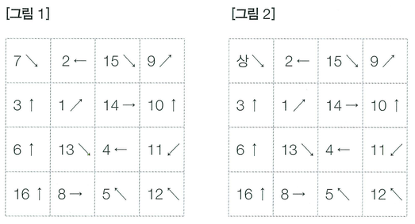
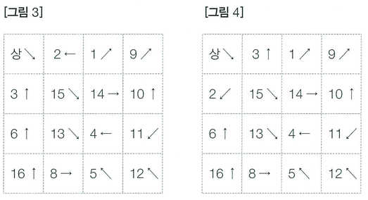
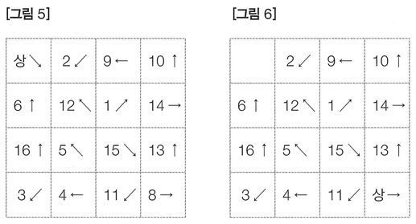

'Q 46의 아기 상어'가 성장해 청소년 상어가 되었습니다.

4 × 4 크기의 공간이 있고, 크기가 1 × 1인 정사각형으로 나누어져 있습니다. 공간의 각 칸은 (x, y)와 같이 표현하며, x는 행의 번호, y는 열의 번호입니다. 한 칸에는 물고기가 1마리 있고, 각 물고기는 번호와 방향을 가지고 있습니다. 번호는 1보다 크거나 같고, 16보다 작거나 같은 자연수이며, 두 물고기가 같은 번호를 갖는 경우는 없습니다. 방향은 8가지 방향(상하좌우, 대각선) 중 하나입니다.

오늘은 청소년 상어가 이 공간에 들어가 물고기를 먹으려고 합니다. 청소년 상어는 (0, 0)에 있는 물고기를 먹고 (0, 0)에 들어가는데, 상어의 방향은 (0, 0)에 있던 물고기의 방향과 같습니다. 이후 물고기가 이동합니다.

물고기는 번호가 작은 물고기부터 순서대로 이동합니다. 물고기는 한 칸을 이동할 수 있고, 이동할 수 있는 칸은 빈칸과 다른 물고기가 있는 칸이고, 이동할 수 없는 칸은 상어가 있거나 공간의 경계를 넘는 칸입니다. 각각의 물고기는 방향이 이동할 수 있는 칸을 향할 때까지 방향을 45도 반시계 방향으로 회전시킵니다. 이동할 수 있는 칸이 없으면 이동을 하지 않지만, 그 외의 경우에는 이동합니다. 물고기가 다른 물고기가 있는 칸으로 이동할 때는 서로의 위치를 바꾸는 방식으로 이동합니다.

물고기의 이동이 모두 끝나면 이번에는 상어가 이동하는데, 상어는 방향에 있는 칸으로 이동할 수 있고 한 번에 여러 개의 칸을 이동할 수 있습니다. 상어가 물고기가 있는 칸으로 이동했다면, 그 칸에 있는 물고기를 먹고, 그 물고기의 방향을 가집니다. 이동하는 중에 지나가는 칸에 있는 물고기는 먹지 않으며 물고기가 없는 칸으로는 이동할 수 없습니다. 상어가 이동할 수 있는 칸이 없으면 공간에서 벗어나 집으로 돌아갑니다. 상어가 이동한 후에는 다시 물고기가 이동하며, 이후 이 과정이 계속해서 반복됩니다.

〈그림 1〉은 청소년 상어가 공간에 들어가기 전 초기 상태입니다. 상어가 공간에 들어가면 (0, 0)에 있는 7번 물고기를 먹고, 상어의 방향은 ↘이 됩니다. 〈그림 2〉는 상어가 들어간 직후의 상태입니다. 이제 물고기가 이동할 차례입니다. 오른쪽 그림을 보면 1번 물고기의 방향은 ↗인데 ↗ 방향에는 칸이 있고, 15번 물고기가 들어있습니다. 물고기가 있는 칸으로 이동할 때는 그 칸에 있는 물고기와 위치를 서로 바꿔야 합니다. 따라서 1번 물고기가 이동을 마치면 〈그림 3〉과 같아집니다.

〈그림 3〉에서 2번 물고기의 방향은 ←인데, 그 방향에는 상어가 있으니 이동할 수 없습니다. 방향을 45도 반시계 회전을 하면 ↙가 되고, 이 칸에는 3번 물고기가 있습니다. 물고기가 있는 칸이니 서로 위치를 바꾸면 〈그림 4〉와 같아집니다.

〈그림 4〉에서 3번 물고기의 방향은 ↑이고, 존재하지 않는 칸입니다. 45도 반시계 회전을 한 방향 ↖도 존재하지 않으니, 다시 회전합니다. ← 방향에는 상어가 있으니 또 회전합니다. ↙ 방향에는 2번 물고기가 있으니 서로의 위치를 교환하면 됩니다. 이런 식으로 모든 물고기가 이동하면 〈그림 5〉와 같아집니다.

물고기가 모두 이동했으니 이제 상어가 이동할 순서입니다. 〈그림 5〉에서 상어의 방향은 ↘이고, 이동할 수 있는 칸은 12번 물고기가 있는 칸, 15번 물고기가 있는 칸, 8번 물고기가 있는 칸 중의 하나입니다. 만약, 8번 물고기가 있는 칸으로 이동하면, 〈그림 6〉과 같아집니다. 상어와 물고기의 움직임이 이럴 때, 상어가 먹을 수 있는 물고기 번호의 합의 최댓값을 구해보세요.

## 함수 설명

`def solution(fish):`

아래 인자를 받는 solution 함수를 완성하세요. 문제 설명과 제한 사항은 함수 인자와 같은 이름을 사용합니다. 배열과 함께 주어지는 개수는 배열 길이와 일치합니다.

- `fish` (정수 배열 배열): 각 행에 물고기 번호와 방향을 번갈아 담은 4 × 8 정수 배열

`fish`는 4 × 8 정수 배열입니다. 각 행은 `[물고기 번호, 방향, 물고기 번호, 방향, ...]`입니다.

`fish[r] = [a_1, b_1, a_2, b_2, a_3, b_3, a_4, b_4]`입니다. a는 물고기 번호, b는 방향입니다.

## 반환값

-  상어가 먹을 수 있는 물고기 번호의 합의 최댓값을 반환합니다.

반환 형식: **정수**.

## 제한 사항

- fish는 4 × 8 정수 배열입니다.
- 물고기 번호 a는 1부터 16까지 한 번씩 등장합니다.
- 방향 b는 1부터 8까지이며 순서대로 ↑, ↖, ←, ↙, ↓, ↘, →, ↗입니다.
