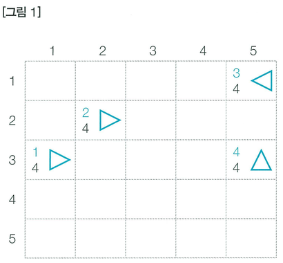
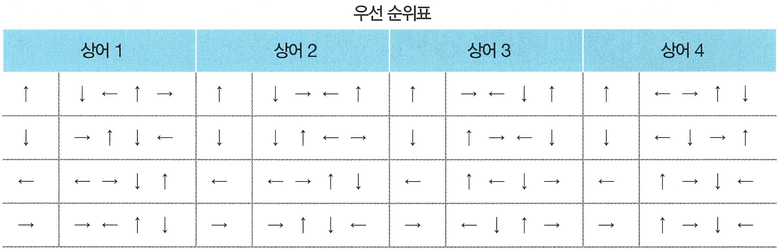
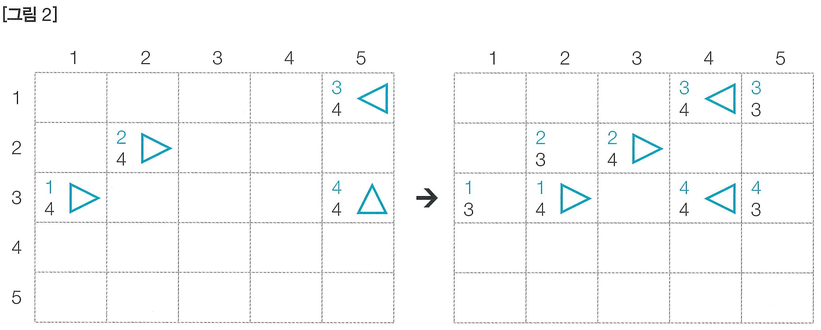
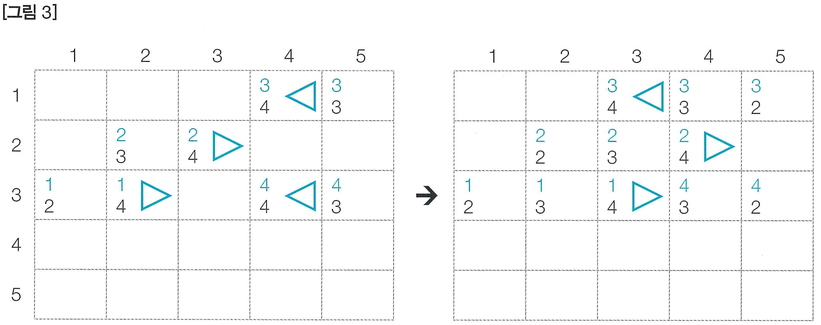
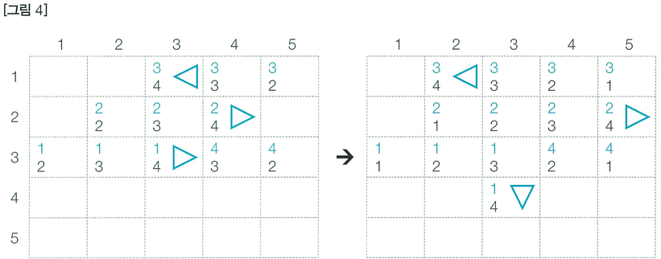
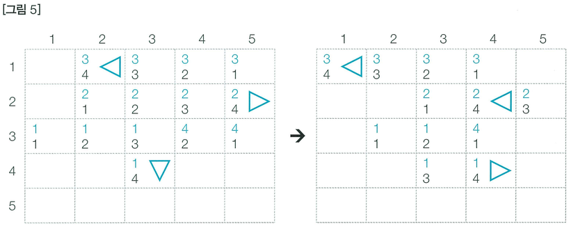

'Q 47 청소년 상어'는 점점 자라 어른 상어가 되었습니다. 상어가 사는 공간에 더 이상 물고기는 오지 않고 다른 상어들만이 남아 있습니다. 상어에는 1 이상 M 이하의 자연수 번호가 붙어 있고, 모든 번호는 서로 다릅니다. 상어들은 영역을 사수하기 위해 다른 상어들을 쫓아내려고 하는데, 1의 번호를 가진 어른 상어가 가장 강력해서 나머지 모두를 쫓아낼 수 있습니다.

N × N 크기의 격자 중 M개의 칸에 상어가 1마리씩 들어 있고, 맨 처음에는 모든 상어가 자신의 위치에 자신의 냄새를 뿌립니다. 그 후 1초마다 모든 상어가 동시에 상하좌우로 인접한 칸 중 하나로 이동하고, 자신의 냄새를 그 칸에 뿌립니다. 냄새는 상어가 k번 이동하고 나면 사라집니다.

각각의 상어가 이동 방향을 결정할 때는, 먼저 인접한 칸 중 아무 냄새가 없는 칸의 방향으로 잡고 그런 칸이 없으면 자신의 냄새가 있는 칸의 방향으로 잡습니다. 이때 가능한 칸이 여러 개일 수 있는데, 그 경우에는 특정한 우선순위를 따릅니다. 우선순위는 상어마다 다를 수 있고, 같은 상어라도 현재 상어가 보고 있는 방향에 따라 또 다를 수 있습니다. 상어가 맨 처음에 보고 있는 방향은 입력으로 주어지고, 그 후에는 방금 이동한 방향이 보고 있는 방향이 됩니다.

모든 상어가 이동한 후 한 칸에 여러 마리의 상어가 남아 있으면, 가장 작은 번호를 가진 상어를 제외하고 모두 격자 밖으로 쫓겨납니다. 그림에서 파란 원은 상어입니다.

〈그림 1〉은 맨 처음에 모든 상어가 자신의 냄새를 뿌린 상태를 나타내며, 〈우선 순위표〉에는 각 상어 및 현재 방향에 따른 우선순위가 표시되어 있습니다. 이 예제에서는 k = 4입니다. 왼쪽 하단에 적힌 정수는 냄새를 의미하고, 그 값은 사라지기까지 남은 시간입니다. 좌측 상단에 적힌 정수는 상어의 번호 또는 냄새를 뿌린 상어의 번호를 의미합니다.

〈그림 2〉는 모든 상어가 한 칸 이동하고 자신의 냄새를 뿌린 상태이고, 〈그림 3〉은 〈그림 2〉의 상태에서 한 칸 더 이동한 것입니다. (2, 4)에는 상어 2와 4가 같이 도달했기 때문에, 상어 4는 격자 밖으로 쫓겨났습니다.

〈그림 4〉는 격자에 남아 있는 모든 상어가 한 칸 이동하고 자신의 냄새를 뿌린 상태, 〈그림 5〉는 〈그림 4〉에서 한 칸 더 이동한 상태를 나타냅니다. 상어 2는 인접한 칸 중에 아무 냄새도 없는 칸이 없으므로 자신의 냄새가 들어 있는 (2, 4)로 이동했습니다. 상어가 이동한 후에, 맨 처음에 각각의 상어가 뿌린 냄새는 사라졌습니다.

이 과정을 반복할 때, 1번 상어만 격자에 남게 되기까지 몇 초가 걸리는지를 구하는 프로그램을 작성하세요.

## 함수 설명

`def solution(n, m, k, board, directions, priorities):`

아래 매개변수는 원문에 등장하는 값과 같은 의미입니다. 배열 길이와 함께 주어지는 개수는 항상 일치합니다. 표준입력을 읽거나 정답을 출력할 필요 없이 결과를 반환하세요.

- `n` (정수): 원문의 N에 해당하는 값
- `m` (정수): 원문의 M에 해당하는 값
- `k` (정수): 원문의 K에 해당하는 값
- `board` (정수 배열 배열): 문제에서 설명한 격자 정보
- `directions` (정수 배열): 상어 번호 순서의 초기 방향 배열
- `priorities` (정수 배열 배열 배열): 상어별, 현재 방향별로 우선 방향 4개를 담은 3차원 배열

`priorities[상어 번호 - 1][현재 방향 - 1]`은 우선순위 방향 4개를 담은 정수 배열입니다.

## 반환값

- 1번 상어만 격자에 남게 되기까지 걸리는 시간을 반환합니다. 단, 1,000초가 넘어도 다른 상어가 격자에 남아 있으면 -1을 반환합니다.

반환 형식: **정수**. 여러 값을 출력하던 문제는 예시와 같이 배열로 반환합니다. 문자열의 대소문자는 예시와 동일하게 맞추세요.

## 제한 사항

N, M 등의 기호는 같은 이름의 소문자 매개변수 또는 해당 배열의 길이를 뜻합니다. 각 배열의 원소 순서와 번호 체계는 문제 설명을 따릅니다.
- 첫 줄에는 N, M, k가 주어집니다. (2 ≤ N ≤ 20, 2 ≤ M ≤ N2, 1 ≤ k ≤ 1,000)
-  격자의 모습이 주어집니다. 0은 빈칸이고, 0이 아닌 수 x는 x번 상어가 들어있는 칸을 의미합니다.
-  각 상어의 방향이 차례대로 주어집니다. 1, 2, 3, 4는 각각 위, 아래, 왼쪽, 오른쪽을 의미합니다.
-  각 상어의 방향 우선순위가 상어당 4줄씩 차례대로 주어집니다. 각 줄은 4개의 수로 이루어져 있습니다. 하나의 상어를 나타내는 네 줄 중 은 해당 상어가 위를 향할 때의 방향 우선순위, 은 아래를 향할 때의 우선순위, 은 왼쪽을 향할 때의 우선순위, 네 번째 줄은 오른쪽을 향할 때의 우선순위입니다. 각 우선순위에는 1부터 4까지의 자연수가 한 번씩 나타납니다. 가장 먼저 나오는 방향이 최우선입니다. 예를 들어, 우선순위가 1 3 2 4라면, 방향의 순서는 위, 왼쪽, 아래, 오른쪽입니다.
- 맨 처음에는 각 상어마다 인접한 빈칸이 존재합니다. 따라서 처음부터 이동을 못 하는 경우는 없습니다.
