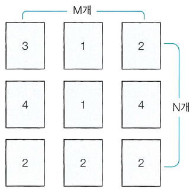

숫자 카드 게임은 여러 개의 숫자 카드 중에서 가장 높은 숫자가 쓰인 카드 한 장을 뽑는 게임이다. 단, 게임의 룰을 지키며 카드를 뽑아야 하고 룰은 다음과 같다.

1. 숫자가 쓰인 카드들이 N × M 형태로 놓여 있다. 이때 N은 행의 개수를 의미하며, M은 열의 개수를 의미한다.
2. 먼저 뽑고자 하는 카드가 포함되어 있는 행을 선택한다.
3. 그다음 선택된 행에 포함된 카드들 중 가장 숫자가 낮은 카드를 뽑아야 한다.
4. 따라서 처음에 카드를 골라낼 행을 선택할 때, 이후에 해당 행에서 가장 숫자가 낮은 카드를 뽑을 것을 고려하여 최종적으로 가장 높은 숫자의 카드를 뽑을 수 있도록 전략을 세워야 한다.

예를 들어 3 × 3 형태로 카드들이 다음과 같이 놓여 있다고 가정하자.

여기서 카드를 골라낼 행을 고를 때 첫 번째 혹은 두 번째 행을 선택하는 경우, 최종적으로 뽑는 카드는 1이다. 하지만 세 번째 행을 선택하는 경우 최종적으로 뽑는 카드는 2이다. 따라서 이 예제에서는 세 번째 행을 선택하여 숫자 2가 쓰여진 카드를 뽑는 것이 정답이다.

카드들이 N × M 형태로 놓여 있을 때, 게임의 룰에 맞게 카드를 뽑는 프로그램을 만드시오.

## 함수 설명

`def solution(n, m, cards):`

아래 매개변수는 원문에 등장하는 값과 같은 의미입니다. 배열 길이와 함께 주어지는 개수는 항상 일치합니다. 표준입력을 읽거나 정답을 출력할 필요 없이 결과를 반환하세요.

- `n` (정수): 원문의 N에 해당하는 값
- `m` (정수): 원문의 M에 해당하는 값
- `cards` (정수 배열 배열): 카드 숫자 또는 카드 묶음 크기

## 반환값

-  게임의 룰에 맞게 선택한 카드에 적힌 숫자를 반환한다.

반환 형식: **정수**. 여러 값을 출력하던 문제는 예시와 같이 배열로 반환합니다. 문자열의 대소문자는 예시와 동일하게 맞추세요.

## 제한 사항

N, M 등의 기호는 같은 이름의 소문자 매개변수 또는 해당 배열의 길이를 뜻합니다. 각 배열의 원소 순서와 번호 체계는 문제 설명을 따릅니다.
-  숫자 카드들이 놓인 행의 개수 N과 열의 개수 M이 공백을 기준으로 하여 각각 자연수로 주어진다. (1 ≤ N, M ≤ 100)
-  각 카드에 적힌 숫자가 주어진다. 각 숫자는 1 이상 10,000 이하의 자연수이다.
