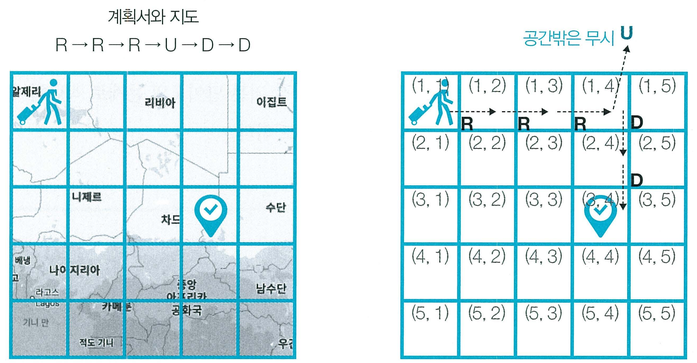

여행가 A는 n × n 크기의 정사각형 공간 위에 서 있다. 이 공간은 1 × 1 크기의 정사각형으로 나누어져 있다. 가장 왼쪽 위 좌표는 (1, 1)이며, 가장 오른쪽 아래 좌표는 (n, n)에 해당한다. 여행가 A는 상, 하, 좌, 우 방향으로 이동할 수 있으며, 시작 좌표는 항상 (1, 1)이다. 우리 앞에는 여행가 A가 이동할 계획이 적힌 계획서가 놓여 있다.

계획서에는 하나의 줄에 띄어쓰기를 기준으로 하여 L, R, U, D 중 하나의 문자가 반복적으로 적혀 있다. 각 문자의 의미는 다음과 같다.

- L: 왼쪽으로 한 칸 이동
- R: 오른쪽으로 한 칸 이동
- U: 위로 한 칸 이동
- D: 아래로 한 칸 이동

이때 여행가 A가 n × n 크기의 정사각형 공간을 벗어나는 움직임은 무시된다. 예를 들어 (1, 1)의 위치에서 L 혹은 U를 만나면 무시된다. 다음은 n = 5인 지도와 계획서이다.

이 경우 6개의 명령에 따라서 여행가가 움직이게 되는 위치는 순서대로 (1, 2), (1, 3), (1, 4), (1, 4), (2, 4), (3, 4)이므로, 최종적으로 여행가 A가 도착하게 되는 곳의 좌표는 (3, 4)이다. 다시 말해 3행 4열의 위치에 해당하므로 (3, 4)라고 적는다. 계획서가 주어졌을 때 여행가 A가 최종적으로 도착할 지점의 좌표를 반환하는 프로그램을 작성하시오.

## 함수 설명

`def solution(n, moves):`

아래 인자를 받는 solution 함수를 완성하세요. 문제 설명과 제한 사항은 함수 인자와 같은 이름을 사용합니다. 배열과 함께 주어지는 개수는 배열 길이와 일치합니다.

- `n` (정수): 문제에서 설명한 n 값
- `moves` (문자열 배열): 이동 명령 문자열들의 배열 (예: ["R", "U"]): 이동 명령 문자열들의 배열 (예: ["R", "U"])

## 반환값

-  여행가 A가 최종적으로 도착할 지점의 좌표 (X, Y)를  반환한다.

반환 형식: **정수 배열**. 여러 값을 출력하던 문제는 예시와 같이 배열로 반환합니다. 문자열의 대소문자는 예시와 동일하게 맞추세요.

## 제한 사항

- 1 ≤ n ≤ 100
- 1 ≤ len(moves) ≤ 100
- moves의 각 원소는 "L", "R", "U", "D" 중 하나입니다.
