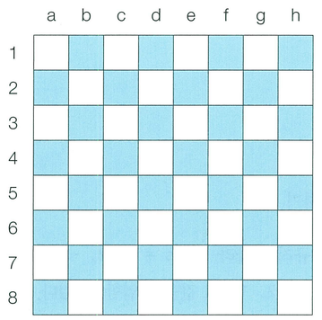

행복 왕국의 왕실 정원은 체스판과 같은 8 × 8 좌표 평면이다. 왕실 정원의 특정한 한 칸에 나이트가 서 있다. 나이트는 매우 충성스러운 신하로서 매일 무술을 연마한다.

나이트는 말을 타고 있기 때문에 이동을 할 때는 L자 형태로만 이동할 수 있으며 정원 밖으로는 나갈 수 없다. 나이트는 특정한 위치에서 다음과 같은 2가지 경우로 이동할 수 있다.

1. 수평으로 두 칸 이동한 뒤에 수직으로 한 칸 이동하기
2. 수직으로 두 칸 이동한 뒤에 수평으로 한 칸 이동하기

이처럼 8 × 8 좌표 평면상에서 나이트의 위치가 주어졌을 때 나이트가 이동할 수 있는 경우의 수를 반환하는 프로그램을 작성하시오. 이때 왕실의 정원에서 행 위치를 표현할 때는 1부터 8로 표현하며, 열 위치를 표현할 때는 a부터 h로 표현한다.

예를 들어 만약 나이트가 a1에 있을 때 이동할 수 있는 경우의 수는 다음 2가지이다. a1의 위치는 좌표 평면에서 구석의 위치에 해당하며 나이트는 정원의 밖으로는 나갈 수 없기 때문이다.

1. 오른쪽으로 두 칸 이동 후 아래로 한 칸 이동하기 (c2)
2. 아래로 두 칸 이동 후 오른쪽으로 한 칸 이동하기 (b3)

또 다른 예로 나이트가 c2에 위치해 있다면 나이트가 이동할 수 있는 경우의 수는 6가지이다. 이건 직접 계산해보시오.

## 함수 설명

`def solution(position):`

아래 인자를 받는 solution 함수를 완성하세요. 문제 설명과 제한 사항은 함수 인자와 같은 이름을 사용합니다. 배열과 함께 주어지는 개수는 배열 길이와 일치합니다.

- `position` (문자열): 나이트의 현재 위치 (예: "a1"): 나이트의 현재 위치 (예: "a1")

## 반환값

-  나이트가 이동할 수 있는 경우의 수를 반환하세요.

반환 형식: **정수**.

## 제한 사항

- position은 "a1"부터 "h8"까지의 체스판 좌표 문자열입니다.
