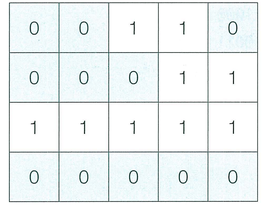

N × M 크기의 얼음 틀이 있다. 구멍이 뚫려 있는 부분은 0, 칸막이가 존재하는 부분은 1로 표시된다. 구멍이 뚫려 있는 부분끼리 상, 하, 좌, 우로 붙어 있는 경우 서로 연결되어 있는 것으로 간주한다. 이때 얼음 틀의 모양이 주어졌을 때 생성되는 총 아이스크림의 개수를 구하는 프로그램을 작성하시오. 다음의 4 × 5 얼음 틀 예시에서는 아이스크림이 총 3개 생성된다.

```
00110
00011
11111
00000
```



## 함수 설명

`def solution(n, m, board):`

아래 매개변수는 원문에 등장하는 값과 같은 의미입니다. 배열 길이와 함께 주어지는 개수는 항상 일치합니다. 표준입력을 읽거나 정답을 출력할 필요 없이 결과를 반환하세요.

- `n` (정수): 원문의 N에 해당하는 값
- `m` (정수): 원문의 M에 해당하는 값
- `board` (정수 배열 배열): 문제에서 설명한 격자 정보

## 반환값

- 한 번에 만들 수 있는 아이스크림의 개수를 반환한다.

반환 형식: **정수**. 여러 값을 출력하던 문제는 예시와 같이 배열로 반환합니다. 문자열의 대소문자는 예시와 동일하게 맞추세요.

## 제한 사항

N, M 등의 기호는 같은 이름의 소문자 매개변수 또는 해당 배열의 길이를 뜻합니다. 각 배열의 원소 순서와 번호 체계는 문제 설명을 따릅니다.
-  얼음 틀의 세로 길이 N과 가로 길이 M이 주어진다. (1 ≤ N, M ≤ 1,000)
-  얼음 틀의 형태가 주어진다.
- 이때 구멍이 뚫려있는 부분은 0, 그렇지 않은 부분은 1이다.
