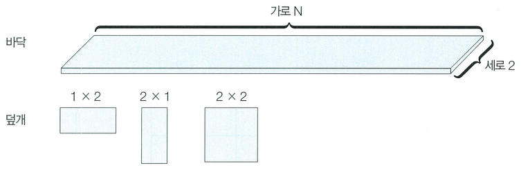

가로의 길이가 n, 세로의 길이가 2인 직사각형 형태의 얇은 바닥이 있다. 태일이는 이 얇은 바닥을 1 × 2의 덮개, 2 × 1의 덮개, 2 × 2의 덮개를 이용해 채우고자 한다.

이때 바닥을 채우는 모든 경우의 수를 구하는 프로그램을 작성하시오. 예를 들어 2 × 3 크기의 바닥을 채우는 경우의 수는 5가지이다.

## 함수 설명

`def solution(n):`

아래 인자를 받는 solution 함수를 완성하세요. 문제 설명과 제한 사항은 함수 인자와 같은 이름을 사용합니다. 배열과 함께 주어지는 개수는 배열 길이와 일치합니다.

- `n` (정수): 문제에서 설명한 n 값

## 반환값

-  2 × n 크기의 바닥을 채우는 방법의 수를 796,796으로 나눈 나머지를 반환한다.

반환 형식: **정수**.

## 제한 사항

- 1 ≤ n ≤ 1,000
